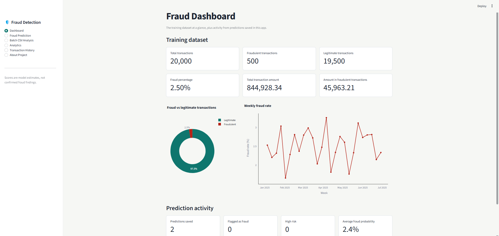
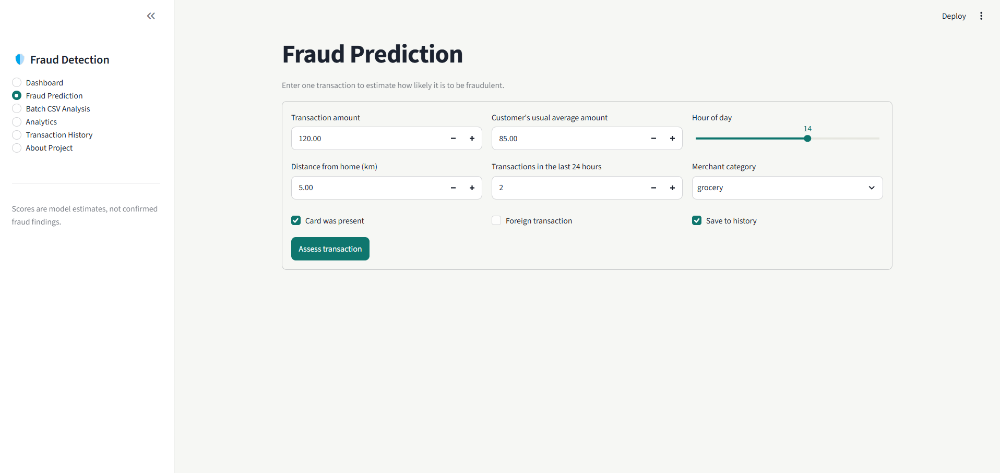
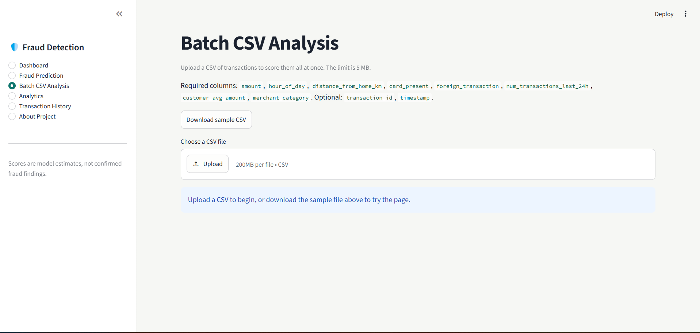
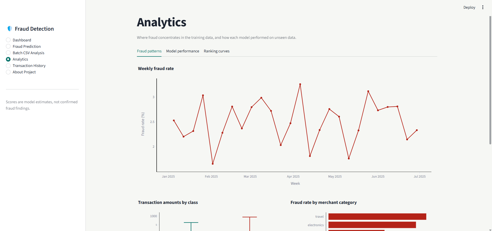
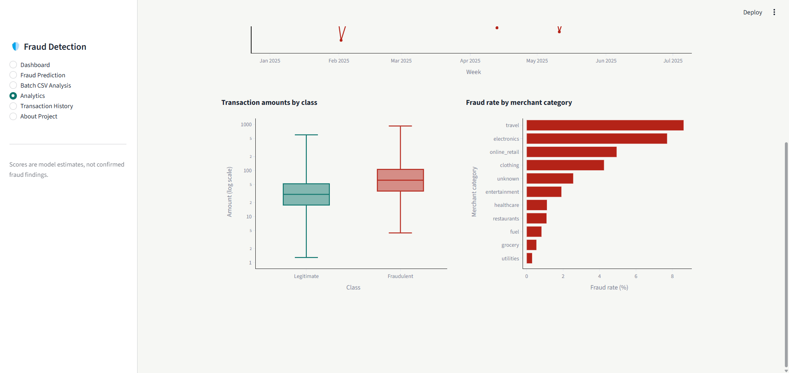
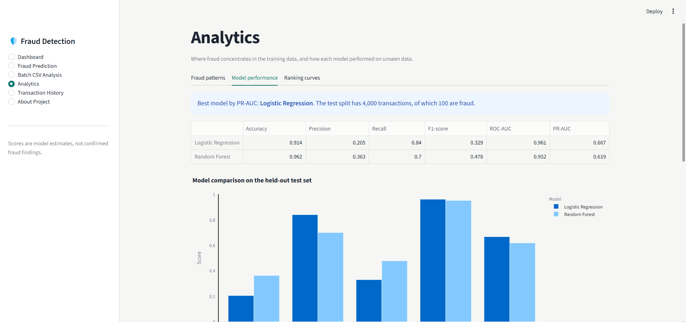
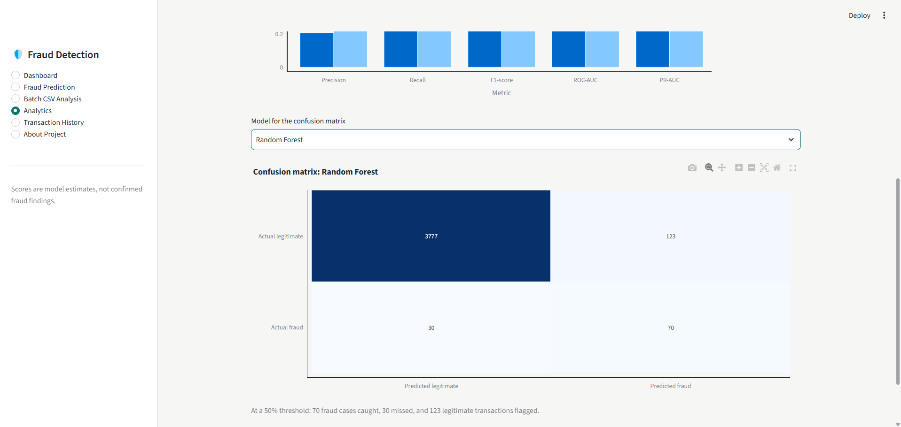
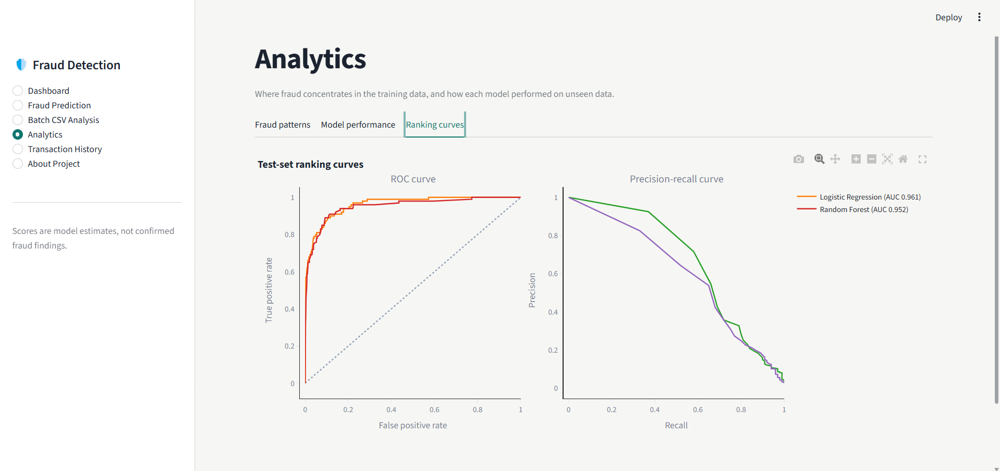
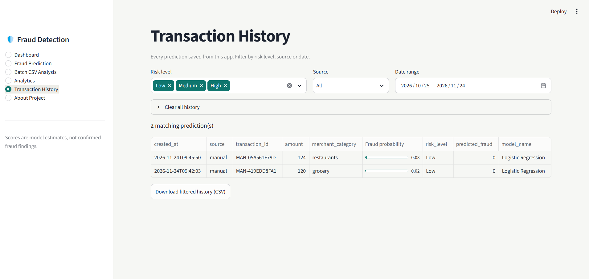
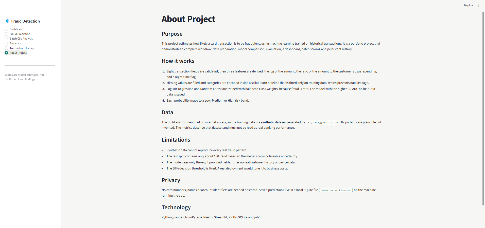

# AI Fraud Detection System

An end-to-end machine learning application that estimates how likely a card transaction is to be fraudulent. It compares two classifiers, saves the better one, and serves it through a Streamlit dashboard with batch CSV scoring, analytics, and a SQLite-backed transaction history.

> **Important:** The training data is a **synthetic dataset** generated by this project, because the build environment had no internet access to download a public dataset. The metrics below describe that synthetic data. They are not real banking results, and every prediction is a model estimate rather than a confirmed fraud finding.

---

## Contents

1. [Features](#features)
2. [Results at a glance](#results-at-a-glance)
3. [Technology stack](#technology-stack)
4. [Architecture](#architecture)
5. [Project structure](#project-structure)
6. [Installation on Windows with VS Code](#installation-on-windows-with-vs-code)
7. [Running the application](#running-the-application)
8. [Running the tests](#running-the-tests)
9. [Dataset information](#dataset-information)
10. [Model training process](#model-training-process)
11. [Evaluation metrics](#evaluation-metrics)
12. [Input validation and security](#input-validation-and-security)
13. [Screenshots](#screenshots)
14. [Limitations](#limitations)
15. [Future improvements](#future-improvements)
16. [Troubleshooting](#troubleshooting)
17. [Verification status](#verification-status)

---

## Features

| Area | What it does |
|---|---|
| **Dashboard** | Total transactions, fraudulent and legitimate counts, fraud percentage, total and fraud amounts, weekly fraud trend, and live prediction statistics from saved history. |
| **Fraud Prediction** | Enter one transaction manually. Shows the fraud probability, a Low / Medium / High risk level, and a disclaimer. Results can be saved to history. |
| **Batch CSV Analysis** | Upload a CSV of transactions. Invalid rows are removed with a warning, missing values are handled, every row is scored, and results can be downloaded or saved. A sample file is included. |
| **Analytics** | Fraud trend over time, amount distribution by class, fraud rate by merchant category, model comparison table and chart, confusion matrix for either model, and ROC and precision-recall curves. |
| **Transaction History** | Stored predictions with filters for risk level, source (manual or batch) and date range. Download the filtered view as CSV. Clear all history behind a confirmation checkbox. |
| **About Project** | Purpose, method, data origin, limitations and privacy notes. |

Machine learning features:

- Preprocessing inside a scikit-learn `Pipeline`, fitted only on training data to avoid data leakage.
- Missing-value imputation (median for numbers, a labelled `unknown` category for merchants).
- Feature engineering: log of the amount, ratio of the amount to the customer's usual spending, and a night-time flag.
- Two models compared on the same held-out test split: **Logistic Regression** and **Random Forest**.
- Class imbalance handled with balanced class weights and stratified splitting. Model selection uses **PR-AUC**, which is more informative than accuracy when fraud is rare.
- The trained model is saved with `joblib` together with its feature list and model name.

---

## Results at a glance

Measured on the included synthetic dataset (20,000 transactions, 2.5% fraud). The test split holds 4,000 transactions, 100 of them fraudulent. Decision threshold 50%.

| Model | Precision | Recall | F1 | ROC-AUC | PR-AUC | Accuracy |
|---|---|---|---|---|---|---|
| **Logistic Regression** (selected) | 0.205 | 0.840 | 0.329 | 0.961 | **0.667** | 0.915 |
| Random Forest | 0.363 | 0.700 | 0.478 | 0.952 | 0.619 | 0.962 |

Logistic Regression was selected because it ranks fraud highest on the PR-AUC metric. It catches 84 of the 100 fraud cases in the test split, at the cost of 326 false alarms. Random Forest is more precise and flags fewer legitimate transactions, but it misses more fraud. Accuracy favours Random Forest, but accuracy is misleading when fraud is rare, which is why it was not used for selection. The threshold can be changed in `config/settings.py` to trade catches for false alarms.

---

## Technology stack

- **Python** 3.11 or newer (the build was tested with Python 3.12)
- **pandas** and **NumPy** for data handling
- **scikit-learn** for preprocessing, models and metrics
- **Streamlit** for the web dashboard
- **Plotly** for interactive charts
- **SQLite** (Python standard library) for transaction history
- **joblib** for saving the trained model
- **pytest** for automated tests

---

## Architecture

```
            ┌──────────────────────────────┐
            │   app.py  (Streamlit UI)     │
            │  6 pages: dashboard, predict, │
            │  batch, analytics, history,  │
            │  about                       │
            └──────┬───────────────┬───────┘
                   │ raw inputs    │ queries / charts
                   ▼               ▼
  src/validation.py          src/analytics.py, src/visualization.py
  (manual + CSV checks)
                   │ clean rows
                   ▼
  src/predictor.py  ──────►  models/fraud_model.joblib
  (scoring, risk bands)       pipeline: FeatureEngineer → ColumnTransformer → model
                   │
                   ▼
  src/database.py  ───────►  data/transactions.db  (SQLite history)

  Training (offline):  scripts/train_model.py
     → src/data_generator.py  (synthetic data)
     → src/model_pipeline.py  (split, train, evaluate, select best)
     → models/fraud_model.joblib + models/evaluation.json
```

---

## Project structure

```
AI_Fraud_Detection/
├── app.py                      Streamlit application (run this)
├── requirements.txt            Python dependencies
├── pytest.ini                  Test configuration
├── README.md                   This file
├── .gitignore
├── .streamlit/
│   └── config.toml             Theme settings
├── config/
│   ├── __init__.py
│   └── settings.py             Paths, feature lists, thresholds, limits
├── src/
│   ├── __init__.py
│   ├── analytics.py            Dataset statistics (pandas only)
│   ├── data_generator.py       Synthetic transaction generator
│   ├── database.py             SQLite storage and queries
│   ├── features.py             Feature engineering transformer
│   ├── model_pipeline.py       Preprocessing, models, training, evaluation
│   ├── predictor.py            Model bundle load/save and scoring
│   ├── validation.py           Manual-input and CSV validation
│   └── visualization.py        Plotly chart builders
├── scripts/
│   └── train_model.py          Generates data, trains, saves the model
├── data/
│   ├── synthetic_transactions.csv   Full training dataset (20,000 rows)
│   ├── sample_transactions.csv      200 unlabelled rows for batch testing
│   └── transactions.db              Created on first run (not in the ZIP)
├── models/
│   ├── fraud_model.joblib      Trained model bundle
│   └── evaluation.json         Metrics, confusion matrices and curve data
├── screenshots/                Place screenshots here (see Screenshots section)
└── tests/
    ├── conftest.py
    ├── test_analytics.py
    ├── test_app.py
    ├── test_data_generator.py
    ├── test_database.py
    ├── test_model.py
    ├── test_preprocessing.py
    └── test_validation.py
```

---

## Installation on Windows with VS Code

These steps assume Windows 10 or 11 and PowerShell, which is the default terminal in VS Code on Windows.

### 1. Install the tools (one time)

1. Install **Python 3.11 or newer** from <https://www.python.org/downloads/>. On the first installer screen, tick **"Add python.exe to PATH"**.
2. Install **Visual Studio Code** from <https://code.visualstudio.com/>.
3. In VS Code, open the Extensions view (`Ctrl+Shift+X`) and install **Python** by Microsoft.

Check the installation by opening a new PowerShell window and running:

```powershell
python --version
```

If that fails, try `py --version`. Use `py` in place of `python` in the commands below if that is the one that works.

### 2. Open the project

1. Unzip `AI_Fraud_Detection.zip` to a folder such as `C:\Projects\`. This creates `C:\Projects\AI_Fraud_Detection\`.
2. In VS Code choose **File → Open Folder…** and select `AI_Fraud_Detection`.

### 3. Create a virtual environment

Open a terminal in VS Code with **Terminal → New Terminal** (or `` Ctrl+` ``). Then run:

```powershell
cd C:\Projects\AI_Fraud_Detection
python -m venv .venv
.venv\Scripts\Activate.ps1
```

When the environment is active, the prompt starts with `(.venv)`.

If PowerShell reports that running scripts is disabled, run this once and answer `Y`, then activate again:

```powershell
Set-ExecutionPolicy -Scope CurrentUser RemoteSigned
.venv\Scripts\Activate.ps1
```

In Command Prompt instead of PowerShell, use `.venv\Scripts\activate.bat`.

### 4. Select the interpreter in VS Code

Press `Ctrl+Shift+P`, type **Python: Select Interpreter**, and choose the entry that points to `.venv` inside this project. This lets the editor, the test runner and the terminal all use the same packages.

### 5. Install the dependencies

With the environment active:

```powershell
python -m pip install --upgrade pip
pip install -r requirements.txt
```

This installs pandas, NumPy, scikit-learn, joblib, Streamlit, Plotly and pytest.

---

## Running the application

From the project folder with the environment active:

```powershell
streamlit run app.py
```

Streamlit prints a local address, normally `http://localhost:8501`, and usually opens it in your browser. If Streamlit asks for an email address on first run, press `Enter` to skip. Stop the server with `Ctrl+C` in the terminal.

The trained model and the sample data are already included, so no training is needed before the first run.

### Using each page

- **Dashboard:** start here for an overview.
- **Fraud Prediction:** fill in the form and select **Assess transaction**. Keep **Save to history** ticked to store the result.
- **Batch CSV Analysis:** download the sample CSV, or use your own file with the required columns, then upload it. Review the warnings, then save the results if you want them in history.
- **Analytics:** explore fraud patterns and compare the models.
- **Transaction History:** filter and export saved predictions, or clear them.
- **About Project:** the method and its limitations.

### Required CSV columns for batch analysis

| Column | Type | Notes |
|---|---|---|
| `amount` | number | Positive. Rows with a missing, zero or negative amount are removed. |
| `merchant_category` | text | One of: grocery, fuel, restaurants, clothing, utilities, healthcare, entertainment, electronics, travel, online_retail, unknown. Other values become `unknown`. |
| `hour_of_day` | integer 0–23 | Rows outside this range are removed. |
| `distance_from_home_km` | number | Missing values are filled with typical values. |
| `card_present` | yes/no, true/false, 1/0 | Unreadable values are filled with typical values. |
| `foreign_transaction` | yes/no, true/false, 1/0 | Unreadable values are filled with typical values. |
| `num_transactions_last_24h` | integer | Missing values are filled with typical values. |
| `customer_avg_amount` | number | The customer's usual spending. Missing values are filled with typical values. |

Optional columns: `transaction_id` (generated if missing) and `timestamp` (ignored by the model). Limits: 5 MB and 50,000 rows per file.

---

## Running the tests

With the environment active, from the project folder:

```powershell
python -m pytest -v
```

The suite has 82 tests in seven files. They cover the generator, feature engineering, the pipelines (including missing values and unseen categories), metrics, model save and load, manual and CSV validation, the SQLite layer, analytics, and the Streamlit pages. The app tests use Streamlit's `AppTest` helper to load every page without a browser, and they are skipped automatically if Streamlit is not installed. In VS Code you can also run the tests from the **Testing** view (flask icon) after choosing pytest as the test framework.

---

## Dataset information

**Source:** generated by `src/data_generator.py`. No real customer data is used or included.

**Why synthetic:** the project was built without internet access, so a public credit-card dataset could not be downloaded. The generator follows the approach described in the project brief: it creates the data if it is missing and documents that the results are not real banking results.

**What the generator simulates:**

- Each of 2,857 customers has a personal spending level. Legitimate transactions cluster around it.
- Fraud is more likely to involve amounts well above a customer's usual spending, night-time hours, distant locations, card-not-present use, foreign transactions, merchant categories such as electronics and travel, and bursts of activity.
- Noise is added so the classes overlap. The task is therefore realistic but not trivial.
- About 2% of values in some columns are missing, so the cleaning code is exercised.

**Included files:**

| File | Rows | Description |
|---|---|---|
| `data/synthetic_transactions.csv` | 20,000 | Full labelled training dataset (`is_fraud` = 1 for fraud). Covers 180 days from 1 January 2025. |
| `data/sample_transactions.csv` | 200 | Unlabelled sample for the Batch CSV Analysis page. Includes a few missing values. |

**Full column list of the training dataset:** `transaction_id`, `timestamp`, `customer_id`, `merchant_category`, `amount`, `hour_of_day`, `distance_from_home_km`, `card_present`, `foreign_transaction`, `num_transactions_last_24h`, `customer_avg_amount`, `is_fraud`.

**Regenerating:** `python scripts\train_model.py --regenerate` rebuilds the data, the sample file, the model and the report. Change the seed or the row count in the generator to create different data.

**Using a real dataset:** this is possible but requires adapting the schema. The public Kaggle "Credit Card Fraud Detection" dataset uses anonymised PCA features (V1–V28), not the columns above, so it cannot be dropped in without changing `config/settings.py`, the feature engineering and the validation rules.

---

## Model training process

Run by `scripts/train_model.py`:

1. **Load or generate** the dataset.
2. **Select inputs.** Eight raw columns are used. `transaction_id`, `customer_id` and `timestamp` are excluded because they identify rows rather than describe behaviour, and using them would allow the model to memorise records.
3. **Split** 80% for training and 20% for testing, stratified so both halves have the same fraud rate.
4. **Pipeline for each model:**
   - `FeatureEngineer`: converts types, normalises category text, and adds `amount_log`, `amount_to_avg_ratio` and `is_night`. It is stateless, so it cannot leak information.
   - `ColumnTransformer`: median imputation and standard scaling for numbers; `unknown` fill and one-hot encoding for categories. Encoding ignores categories not seen during training.
   - Estimator: Logistic Regression (`class_weight="balanced"`) or Random Forest (150 trees, depth 8, `class_weight="balanced_subsample"`).
5. **Fit** each pipeline on the training split only, then **evaluate** on the test split.
6. **Select** the model with the highest PR-AUC.
7. **Save** the selected pipeline with its feature list and model name to `models/fraud_model.joblib`, and the full report to `models/evaluation.json`.

Training takes a short time on a typical laptop; the exact duration depends on hardware.

---

## Evaluation metrics

- **Precision:** of the transactions flagged as fraud, the share that really were fraud.
- **Recall:** of the real fraud, the share that was flagged.
- **F1-score:** the harmonic mean of precision and recall.
- **ROC-AUC:** how well the model ranks fraud above legitimate transactions across all thresholds.
- **PR-AUC (average precision):** the same idea focused on the rare fraud class. This is the selection metric.
- **Confusion matrix:** counts of true and false positives and negatives at the 50% threshold. The Analytics page shows it for either model.

Accuracy is shown in the tables for completeness but is not used for decisions. A model that never flags fraud would still score about 97.5% accuracy on this data.

**Risk bands** map each probability to a level: below 30% is **Low**, from 30% to below 70% is **Medium**, and 70% or above is **High**. These thresholds are set in `config/settings.py`.

---

## Input validation and security

- **Manual form:** every value is checked against a range or list. Errors are shown beside the form and nothing is scored or saved.
- **CSV uploads:** size limit (5 MB), row limit (50,000), header normalisation, required-column check, type conversion, range checks, and friendly messages for empty, unreadable or malformed files.
- **Bad rows:** rows that cannot be scored are removed and counted in a visible warning. Missing optional values are filled and reported.
- **SQL:** every query uses parameter placeholders. User text is never formatted into SQL, and a test confirms that an injection attempt is treated as plain text.
- **Privacy:** the app does not ask for card numbers, names or account identifiers. Saved history stays in a local file on the machine running the app.

---

## Screenshots

**No screenshots are included in this package.** The build environment could not start Streamlit or open a browser, so no real screenshot of the running application exists. The `screenshots/` folder is ready for them.

To add them yourself on Windows:

1. Run `streamlit run app.py` and open the app in your browser.
2. Use the Windows Snipping Tool (`Win+Shift+S`) to capture the Dashboard, Fraud Prediction (after an assessment), Batch CSV Analysis, Analytics and Transaction History pages.
3. Save them in `screenshots\` with descriptive names, for example `dashboard.png`.
4. Add them to this section with ``.

---

## Limitations

- **Synthetic data.** The patterns were designed by hand, so the models have learned those patterns and not real fraud behaviour. Real-world performance would almost certainly be lower and different.
- **Small fraud sample in the test split.** There are only 100 fraud cases, so precision and PR-AUC carry noticeable uncertainty. The two models are close, and a different random split could reorder them.
- **Limited inputs.** The model sees only the eight provided fields. Real systems also use device data, merchant history, customer history over long periods, and network signals.
- **Fixed threshold.** The 50% decision threshold is not tuned to the cost of missed fraud versus false alarms, which a real deployment would do.
- **Probabilities at extremes.** Logistic Regression can return values very close to 0% or 100% for unusual inputs. Treat them as relative risk scores, not calibrated real-world odds.
- **Single-user local app.** There is no login, no multi-user isolation and no audit trail. It is designed to run on one machine.
- **No real-time scoring.** Transactions are scored when they are submitted, not as a stream.

---

## Future improvements

- Calibrate probabilities (for example with isotonic regression) so the percentages mean more.
- Add gradient boosting (XGBoost or LightGBM) and a hyperparameter search with time-based cross-validation.
- Tune the decision threshold against a cost matrix for missed fraud and false alarms.
- Add SHAP explanations so each prediction shows which factors drove it.
- Support a real public dataset through a documented adapter.
- Add user accounts, a review workflow where analysts mark predictions as confirmed or dismissed, and feedback into retraining.
- Package the app with Docker for one-command deployment.

---

## Troubleshooting

**"No trained model found"** – run `python scripts\train_model.py` from the project folder. The model should already be included, so this usually means the file was moved or deleted.

**`ModuleNotFoundError: No module named 'streamlit'` or similar** – the virtual environment is probably not active. Run `.venv\Scripts\Activate.ps1`, then `pip install -r requirements.txt`. Check the interpreter selected in VS Code.

**`.venv\Scripts\Activate.ps1 cannot be loaded because running scripts is disabled`** – run `Set-ExecutionPolicy -Scope CurrentUser RemoteSigned`, answer `Y`, and try again.

**Warnings about scikit-learn versions when loading the model** – the model was saved with scikit-learn 1.9.1. A different version may print a warning. Re-run `python scripts\train_model.py --regenerate` to save a model that matches your installed version.

**Port already in use** – another Streamlit app is running. Stop it, or start this one on another port with `streamlit run app.py --server.port 8502`.

**Batch upload rejected** – check the column names listed above, and save the file as CSV with UTF-8 encoding. Excel's "CSV UTF-8" option works well.

**Want a fresh history** – open Transaction History, expand **Clear all history**, tick the confirmation, and select **Delete all history**. Or delete `data\transactions.db` while the app is stopped.

---

## Verification status

This section states exactly what was and was not tested, so there is no ambiguity about the build.

**Tested in the build environment (Python 3.12, pandas 3.0.6, NumPy 2.5.4, scikit-learn 1.9.1, joblib 1.6.0):**

- Synthetic data generation, including reproducibility, value ranges, missing-value injection and invalid-argument rejection.
- Feature engineering and both pipelines: fitting, predicting with missing values, and handling categories not seen in training.
- Train/test splitting, metric computation (including single-class edge cases), curve generation, risk-band boundaries, model save and load, and the shipped model file.
- Manual-input validation, CSV reading and validation (empty files, header-only files, missing columns, all rows invalid, messy but usable files, row and size limits).
- SQLite storage: save, fetch with risk, source and date filters, summary statistics, delete, NaN handling and SQL-injection safety.
- Analytics functions.
- An end-to-end run of the batch and manual flows, using the shipped model and sample file, with a temporary database.

The 75 non-UI tests were run through a small stand-in runner in the build environment, because pytest and Streamlit could not be installed (no network access). The test files are standard pytest files, so `python -m pytest -v` runs them normally.

**Not executed in the build environment:**

- **The Streamlit user interface.** Streamlit and Plotly could not be installed, so the pages and charts were syntax-checked but not run. The seven `AppTest` smoke tests were skipped. They run automatically once Streamlit and Plotly are installed.
- **Real pytest.** The test suite has not been run under pytest itself in this build. Running `python -m pytest -v` on your machine is the first thing to do.
- **Screenshots.** None were captured (see the Screenshots section).

Before relying on the application, run `python -m pytest -v` and `streamlit run app.py` on your own machine and check each page.

## Screenshots

### Dashboard


### Fraud Prediction


### Batch CSV Analysis


### Analytics






### Transaction History


### About Project
